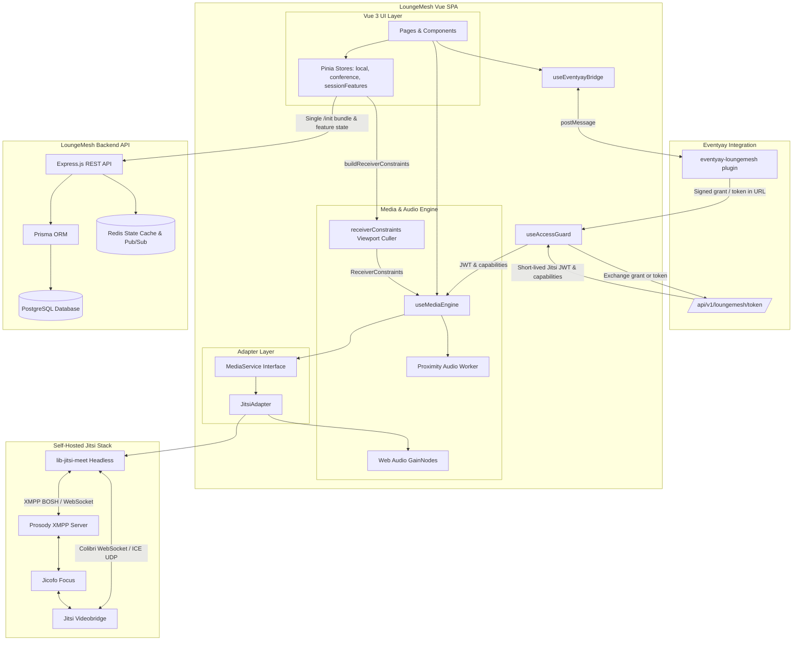

# Architecture

LoungeMesh is an informal spatial video lounge engineered for online and hybrid events. It allows participants to navigate freely as avatars across a 2D floorplan with realistic proximity-based audio and video attenuation.



---

## Architectural Principles

### 1. Headless WebRTC (No Iframe API)
LoungeMesh does not embed the standard Jitsi Meet iframe. Instead, it interacts directly with `lib-jitsi-meet` via pure JavaScript with multi-stream signaling (`sourceNameSignaling`, `sendMultipleVideoStreams`, `receiveMultipleVideoStreams`) and `testing.allowMultipleTracks` enabled. `JitsiAdapter` also subscribes to remote `track.videoTypeChanged` events so delayed XMPP `<SourceInfo>` updates cleanly promote camera-off `-v0` desktop tracks into `screenshare` without clobbering camera video, and mic toggles exclude active tab-share `screenshareAudio`.

### 2. Strict Adapter Boundary
Vue components and Pinia stores never interact directly with `lib-jitsi-meet`. All WebRTC interactions flow through the `MediaService` interface implemented by `JitsiAdapter.ts`. This decouples the UI from WebRTC implementation details and enables mock testing with 100% test coverage.

### 3. Spatial Viewport Culling & Video Budgeting
To maintain low CPU and network utilization on low-spec hardware (2 vCPU / 2 GB RAM), LoungeMesh dynamically computes which avatars are within the visible screen area, speaking on stage, or actively sharing their screen:
- Off-screen participants without stage or active screenshare streams have their video subscriptions culled (`selectedSources = []`, `lastN = 0`), consuming zero incoming video bandwidth.
- Avatar cameras are capped at 360p (ideal) / 480p (max) at 24 fps.
- Desktop screensharing is constrained to 720p at 15–30 fps, and admitted active sharers remain subscribed in `usersOnStage` so `SharedScreens.vue` receives frames even when the sharer's avatar is panned off-screen.

### 4. Single-Roundtrip State Bundling
When a participant enters a room, the frontend queries `/api/meetings/state/:roomName/init` in a single HTTP request. This endpoint aggregates:
- Participant role resolution (`host`, `moderator`, `attendee`).
- Public room configuration (with `joinPin` strictly sanitized).
- Collaborative whiteboard strokes from Redis/database.
- Shared session notes and notes templates.
- Active live polls and participant vote state.
- Dynamic room permissions and background floorplans.

If the bundled endpoint is unavailable, the frontend gracefully falls back to individual REST endpoints.

### 5. Multi-Tier State Architecture
- **Ephemeral Real-Time Audio/Video**: Negotiated peer-to-bridge via Jitsi Videobridge (JVB) and XMPP signaling via Prosody.
- **Fast Session State**: Collaborative whiteboard strokes, shared notes, active polls, and room settings are cached in Redis for sub-millisecond retrieval.
- **Persistent Data**: Scheduled meetings, user profiles, room configurations, and audit session logs are persisted in PostgreSQL via Prisma ORM.

### 6. Off-Thread Web Audio Spatial Math
Avatar coordinates on the 2D floorplan are processed by a dedicated Web Worker (`proximityAudio.worker.ts`). Distance vectors and attenuation coefficients are calculated off the browser's main thread and applied to Web Audio `GainNode` audio instances with smooth exponential ramps to eliminate audio popping.

---

## Key Modules

### Frontend (`src-vue/`)

| Path | Responsibility |
|---|---|
| `src-vue/services/MediaService.ts` | Backend-agnostic WebRTC contract interface |
| `src-vue/services/JitsiAdapter.ts` | Jitsi WebRTC driver, track management, Web Audio node routing |
| `src-vue/utils/receiverConstraints.ts` | Viewport culling and Jitsi receiver constraints calculator |
| `src-vue/composables/useMediaEngine.ts` | Media engine singleton coordinator and track lifecycle manager |
| `src-vue/composables/useAccessGuard.ts` | Eventyay token exchange and access control gatekeeper |
| `src-vue/composables/useEventyayBridge.ts` | postMessage bridge for parent event portal integration (e.g. embedding the LoungeMesh SPA within Eventyay; media rendering itself remains strictly headless without Jitsi iframes) |
| `src-vue/stores/localStore.ts` | Local user position, mic/camera mute states, and audio settings |
| `src-vue/stores/conferenceStore.ts` | Remote participant track registry and connection status |
| `src-vue/stores/sessionFeaturesStore.ts` | Whiteboard, shared notes, live polls, stage, and permission state |
| `src-vue/workers/proximityAudio.worker.ts` | Off-thread proximity calculation and volume attenuation |

### Backend (`server/`)

| Path | Responsibility |
|---|---|
| `server/src/controllers/meetingController.ts` | Meeting lifecycle, `/init` state bundling, config sanitization |
| `server/src/controllers/authController.ts` | Session authentication and token management |
| `server/src/routes/meetingRoutes.ts` | REST API routes for meetings, whiteboard, notes, polls, access |
| `server/prisma/schema.prisma` | PostgreSQL schema models for Users, Meetings, Configs, Logs |

---

## Data Flows

### 1. Room Initialization Flow

```
User navigates to /session/<roomName>
  ↓
sessionFeaturesStore.fetchRoomConfigAndRole()
  ↓
GET /api/meetings/state/<roomName>/init
  ↓
Express queries PostgreSQL (Prisma) & Redis in parallel
  ↓
Response bundles: { role, config (PIN sanitized), whiteboard, notes, access, poll, background }
  ↓
Stores initialized synchronously in single render cycle
  ↓
useMediaEngine.connect() joins Jitsi conference room
```

### 2. Spatial Video Subscription Flow

```
User pans/zooms 2D room canvas or peers move
  ↓
localStore.calculateUsersOnScreen() detects viewport intersections
  ↓
buildReceiverConstraints({ visibleUserIds, stageIds, localId })
  ↓
If no users visible or on stage:
  selectedSources = [], lastN = 0 (Zero video streamed from bridge)
If users visible or on stage:
  selectedSources = [id-v0, ...], constraints = { maxHeight: 360 | 720 }
  ↓
JitsiAdapter.setReceiverConstraints() sends Colibri message to JVB
  ↓
JVB forwards only the requested video streams at designated resolutions
```
